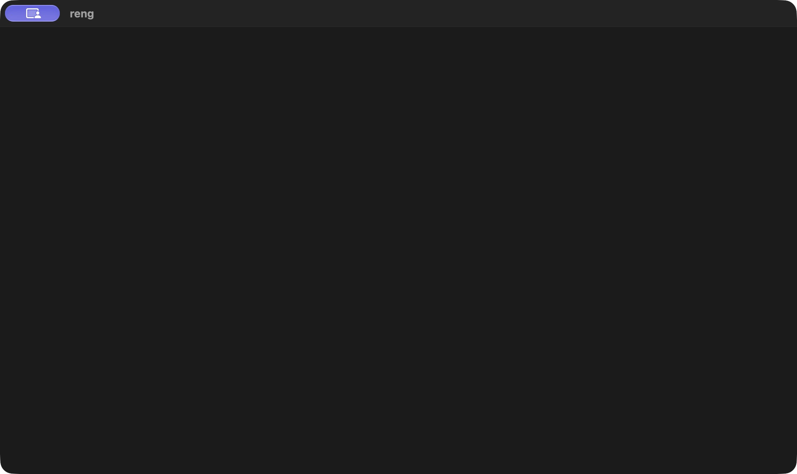

# reng

A game engine written in Rust, intended for macOS, Windows, and web through WebAssembly.

## Current milestone

`reng` opens a resizable native window titled **reng**, initially 960 × 540 logical pixels. Closing the window exits the application. The event loop sleeps while idle; there is no drawing or GPU initialization yet.

Window management uses [winit](https://docs.rs/winit/0.30.13/winit/). Rendering with [wgpu](https://wgpu.rs/) and browser packaging are planned.

`main.rs` starts `WindowHandler` with `WindowSpecs::default()`. The specs hold the title, logical width and height, and resizable flag. All `winit` integration and window lifecycle logic live in `src/window.rs`.

## Run

Use a stable Rust toolchain supporting the Rust 2024 edition:

```sh
cargo run --locked
```

Drag a window edge or corner to resize it, then use the native close button to exit.

## Checks

```sh
cargo fmt --all -- --check
cargo clippy --all-targets --locked -- -D warnings
cargo test --locked
```

For the planned web target, compilation can be checked with:

```sh
rustup target add wasm32-unknown-unknown
cargo check --locked --target wasm32-unknown-unknown
```

This checks compilation only. Browser startup and canvas integration are not implemented.

## macOS proof of concept

The window was opened, resized with the native zoom/restore control, and closed successfully on macOS. Windows and WebAssembly compilation checks also pass; Windows runtime and browser startup have not been tested.


